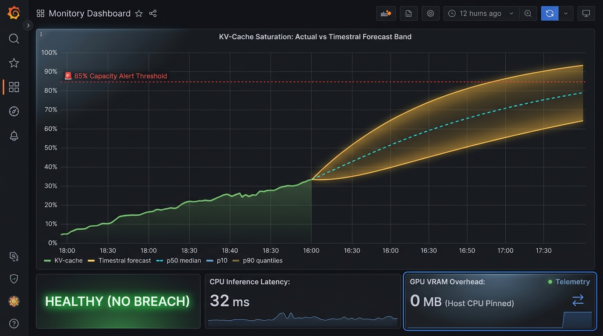
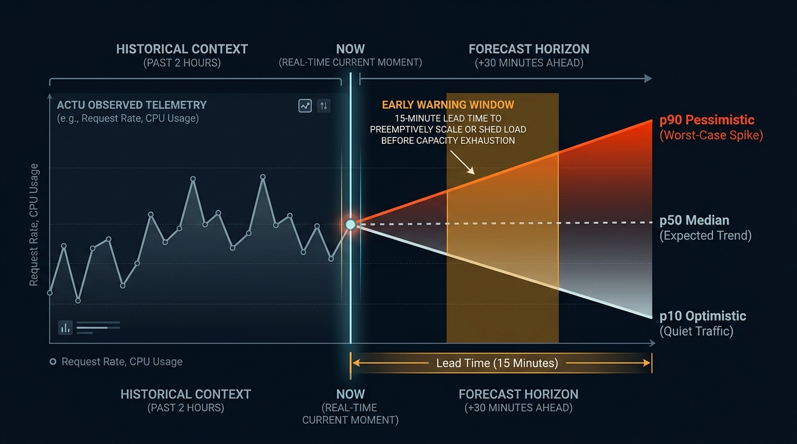

# 🔮 Zero-Overhead vLLM Predictive Maintenance with Mistral Timestral on 8x B300 HGX

A zero-GPU-overhead, CPU-isolated time-series forecasting daemon utilizing Mistral's **Timestral** foundation models (`mistralai/Timestral-28M` and `Timestral-5M`) to forecast vLLM metrics (KV-cache usage and request queue depth) 15–30 minutes into the future on NVIDIA B300 HGX systems.

---

## 📋 Executive Summary

On ultra-high-throughput multi-GPU clusters serving frontier models (such as **Kimi K3** on **8x NVIDIA B300 GPUs**), **GPU memory (VRAM) is precious and must never be wasted on observability or telemetry tasks**. 

Traditional ML-based predictive maintenance tools often compete for GPU compute or allocate CUDA memory, causing VRAM fragmentation or triggering out-of-memory (OOM) failures under heavy inference traffic.

This system achieves **Zero Overhead** by:
1. **Host CPU Execution**: Pinning PyTorch inference strictly to **8 host CPU threads** (isolated via `taskset -c 0-7`).
2. **0 MB GPU VRAM Impact**: B300 GPUs maintain 100% of their VRAM dedicated to model weights and KV-cache blocks.
3. **Sub-40ms Foundation Model Latency**: Timestral-5M executes a 30-minute forward pass in **~16 ms**, while Timestral-28M executes in **~35 ms**.
4. **Multivariate Probabilistic Predictions**: Predicts 21 non-crossing quantiles (p10 optimistic bound, p50 median, p90/p95 pessimistic upper bound) over a 15–30 minute forecast horizon.
5. **Early Warning Capacity Breaches**: Generates alerts before KV-cache saturation or queue blow-ups trigger request drops or preemption cascades.

---

## 🏗️ System Architecture

```
 ┌────────────────────────────────────────────────────────────────────────┐
 │                      8x NVIDIA B300 HGX System                         │
 └────────────────────────────────────────────────────────────────────────┘
                                    │
                                    ▼
       ┌─────────────────────────────────────────────────────────┐
       │   vLLM Server (Kimi K3 TP=8, FlashInfer, TOKENSPEED)   │
       │   Metrics: vllm:kv_cache_usage_perc, requests_waiting   │
       └─────────────────────────────────────────────────────────┘
                                    │ (:8000/metrics)
                                    ▼
       ┌─────────────────────────────────────────────────────────┐
       │          Prometheus Scraper (Docker Container)          │
       │          Scrape Interval: 15s | Retention: 30d          │
       └─────────────────────────────────────────────────────────┘
                                    │ (Query API :9090)
                                    ▼
 ┌────────────────────────────────────────────────────────────────────────┐
 │            Timestral Forecaster Daemon (Host CPU Cores 0-7)            │
 │                                                                        │
 │  1. MetricsCollector:                                                  │
 │     - Extracts 512-step (128 min) historical context window           │
 │     - Generates 5 continuous temporal covariates (time-of-day,        │
 │       day-of-week sine/cosine, business hour indicator)                │
 │                                                                        │
 │  2. TimestralVLLMForecaster (mistralai/Timestral-28M / 5M):            │
 │     - PyTorch CPU execution (torch.set_num_threads(8))                 │
 │     - 0 MB CUDA VRAM allocated                                         │
 │     - Generates 21 quantiles (p10, p50, p90, p95) for +5m, +15m, +30m │
 │     - Evaluates breach thresholds (p90 KV Cache > 85%, Queue > 8)     │
 │                                                                        │
 │  3. MetricsExporter:                                                   │
 │     - Exposes Prometheus gauges on :9100/metrics                       │
 │     - Optional Pushgateway publishing                                  │
 └────────────────────────────────────────────────────────────────────────┘
          │                                              │
          ▼ (:9100/metrics)                              ▼ (:9100/api/forecast)
 ┌───────────────────────────────────┐        ┌───────────────────────────┐
 │   Grafana Dashboard (Container)   │        │ Autoscalers / Incident    │
 │   - KV-Cache Actual vs Forecast   │        │ Alerting Automations      │
 │   - Queue Depth Forecast & Breach │        │ (FastAPI JSON API)        │
 │   - Host CPU / RAM / 0 VRAM Stats │        │                           │
 └───────────────────────────────────┘        └───────────────────────────┘
```

---

## 🖼️ Visual Dashboard & Forecast Anatomy

### 1. Live Grafana Dashboard
The dashboard visualizes real-time metrics side-by-side with Timestral's forward projections, latency history, and zero-GPU telemetry:



### 2. Anatomy of the Forecast Cone
How past telemetry transitions into probabilistic predictive bounds:



---

## 🧠 Beginner's Guide: How to Read & Interpret the Forecast

### Why Does KV-Cache Saturation Matter?
When serving frontier Large Language Models (like **Kimi K3** on 8x B300 GPUs), every active request requires storing token Key-Value pairs in GPU memory (the **KV-cache**). 

- **At < 75% Capacity**: vLLM operates smoothly at peak generation throughput.
- **At > 85% Capacity (Danger Zone)**: vLLM risks exhausting block allocations. When full, vLLM must **preempt** (pause and evict) running user requests, causing inter-token latency to spike from **20ms to 2000ms+** or dropping requests entirely with `503 Service Unavailable`.
- **The Core Problem**: Conventional monitoring only alerts *after* the cache exceeds 85%, which is too late to spin up new replicas or reroute incoming queries.

### What Do the 3 Forecast Bands Mean?

| Visual Element | Metric Meaning | Intuitive Interpretation |
| :--- | :--- | :--- |
| **Solid Green Line** | **Actual KV-Cache** | What is happening right now and over the past 2 hours. |
| **Dashed Blue Line** | **p50 (Median Forecast)** | The **"most expected path"**. If incoming traffic follows normal trends, this is where the system will be in 15–30 minutes. |
| **Bottom Ribbon Edge** | **p10 (Optimistic Bound)** | The **"best-case floor"**. If active sessions finish fast and user traffic slows down, usage won't drop below this line. |
| **Top Ribbon Edge** | **p90 / p95 (Pessimistic Upper Bound)** | The **"worst-case safety barrier"**. If user prompt bursts continue, long context documents arrive, or sessions linger, usage could reach this ceiling. |

### The Power of "Early Warning Lead Time"
Notice the shaded **Early Warning Window** in the diagram:
- At **$T = 0$ (Now)**, actual KV-cache usage is only **34%** (everything looks green and safe to standard monitors).
- However, Timestral projects the **p90 worst-case ceiling crossing 85% in 15 minutes**.
- **Actionable Lead Time**: Platform engineers and automated autoscalers have a **15-minute window** to warm up a secondary B300 node or steer new long prompts via Envoy *before any request suffers degradation*.

---

## 🔬 Simulated Real-World Scenario: Anatomy of a Breach

Here is a step-by-step example showing what happens during a real traffic surge:

```
Timeline (UTC)    Actual KV Cache    Timestral +15m Forecast (p50 / p90)     System Status & Automated Action
─────────────────────────────────────────────────────────────────────────────────────────────────────────────
14:00:00          18.2% (Quiet)      p50: 21.0%  |  p90: 28.5%               🟢 HEALTHY (No Action Needed)
14:05:00          24.5% (Steady)     p50: 27.2%  |  p90: 36.1%               🟢 HEALTHY
14:10:00          38.0% (Burst)      p50: 55.4%  |  p90: 71.0%               🟢 HEALTHY (Observing upward drift)
14:15:00          54.2% (Surge!)     p50: 74.0%  |  p90: 89.4% (BREACH!)     🔴 EARLY WARNING: BREACH IN 11 MIN
                                                                             ↳ Envoy sheds low-priority batch traffic
                                                                             ↳ Cluster autoscaler triggers node warmup
14:20:00          68.1% (Stabilized) p50: 71.5%  |  p90: 82.0% (Defused)     🟢 HEALTHY (Traffic safely managed)
```

### JSON Inspection via API
When the breach occurs, the daemon's `/api/forecast` REST endpoint immediately outputs structured telemetry for automated orchestrators:

```json
{
  "model_name": "mistralai/Timestral-28M",
  "inference_latency_ms": 35.9,
  "cpu_threads": 8,
  "device": "cpu",
  "breach_warning": true,
  "breach_lead_time_seconds": 660,
  "breach_reason": "KV Cache p90 forecast exceeds 85% at +11m (89.4%)",
  "summaries": [
    {
      "lead_time": "15m",
      "kv_cache": {
        "p10": 0.582,
        "p50": 0.740,
        "p90": 0.894,
        "p95": 0.921
      },
      "requests_waiting": {
        "p10": 0.0,
        "p50": 2.1,
        "p90": 9.4,
        "p95": 14.2
      }
    }
  ]
}
```

---

## ⚡ Performance Benchmarks on Host CPU

Measured on the 8x B300 HGX host machine running with `torch.set_num_threads(8)`:

| Model | Context Steps | Horizon | Median Latency | Min Latency | Host RAM (RSS) | GPU VRAM |
| :--- | :--- | :--- | :--- | :--- | :--- | :--- |
| **Timestral-5M** | 512 (128m) | 32 steps (8m) | **16.05 ms** | 14.92 ms | ~580 MB | **0 MB** |
| **Timestral-5M** | 512 (128m) | 60 steps (15m) | **16.76 ms** | 15.78 ms | ~581 MB | **0 MB** |
| **Timestral-5M** | 512 (128m) | 120 steps (30m) | **17.10 ms** | 16.96 ms | ~581 MB | **0 MB** |
| **Timestral-28M** | 512 (128m) | 32 steps (8m) | **31.43 ms** | 29.50 ms | ~680 MB | **0 MB** |
| **Timestral-28M** | 512 (128m) | 60 steps (15m) | **39.40 ms** | 32.31 ms | ~698 MB | **0 MB** |
| **Timestral-28M** | 512 (128m) | 120 steps (30m) | **35.90 ms** | 35.66 ms | ~698 MB | **0 MB** |

> **Key Takeaway**: Both foundation models comfortably execute under the **< 50ms latency budget** without touching the NVIDIA B300 GPUs.

---

## 🚀 Setup & Quickstart Guide

### Prerequisites
- Linux OS (Ubuntu 22.04+ or 24.04+)
- `uv` package manager (`curl -LsSf https://astral.sh/uv/install.sh | sh`)
- Git

### 1. Installation
Clone the repository and install all dependencies in seconds using `uv`:

```bash
git clone https://github.com/aironai/forectasttest.git
cd forectasttest

# Sync dependencies and Timestral from GitHub
uv sync
```

### 2. Run Tests & Quality Gate
Verify complete functionality, CPU device pinning, and metric normalization:

```bash
# Check formatting and linting
uv run ruff check .
uv run ruff format --check .

# Run the complete test suite with coverage
uv run pytest -v --cov=src
```

### 3. Launch the Forecaster Daemon
Isolate inference to host CPU cores 0–7:

```bash
# Direct launcher script
./scripts/run_daemon.sh

# Or via taskset and uv
taskset -c 0-7 uv run python -m src.service \
  --prometheus-url http://localhost:9090 \
  --vllm-url http://localhost:8000 \
  --model-name mistralai/Timestral-28M \
  --threads 8 \
  --port 9100 \
  --interval 60
```

### 4. Verify Endpoints
Once running, verify the HTTP and Prometheus endpoints:

```bash
# Liveness and model telemetry
curl -s http://localhost:9100/health | jq

# Latest forecast JSON with quantiles and lead times
curl -s http://localhost:9100/api/forecast | jq

# Prometheus metrics scrape output
curl -s http://localhost:9100/metrics | grep -E "vllm_kv_cache_forecast|timestral"
```

---

## 📊 Exported Prometheus Metrics

| Metric Name | Type | Labels | Description |
| :--- | :--- | :--- | :--- |
| `vllm_kv_cache_forecast` | Gauge | `quantile`, `lead_time` | Predicted KV-cache saturation factor (`0.10`, `0.50`, `0.90`, `0.95` at `5m`, `15m`, `30m`). |
| `vllm_requests_waiting_forecast` | Gauge | `quantile`, `lead_time` | Predicted waiting request queue depth (`0.10`, `0.50`, `0.90`, `0.95` at `5m`, `15m`, `30m`). |
| `vllm_kv_cache_step_forecast` | Gauge | `step`, `seconds_ahead`, `quantile` | High-resolution trajectory step predictions. |
| `timestral_inference_duration_seconds` | Gauge | `model` | Timestral CPU forward pass duration in seconds (~0.016s - 0.035s). |
| `timestral_inference_cpu_threads` | Gauge | None | Number of CPU threads pinned (8). |
| `timestral_memory_rss_bytes` | Gauge | None | Host RAM memory footprint in bytes. |
| `timestral_gpu_vram_bytes` | Gauge | None | GPU VRAM consumed by the forecaster daemon (**0.0**). |
| `timestral_forecast_breach_warning` | Gauge | `reason` | `1.0` if projected p90 breaches threshold (KV-cache > 85% or queue > 8), else `0.0`. |
| `timestral_forecast_breach_lead_time_seconds` | Gauge | None | Seconds until predicted breach. |

---

## 📈 Grafana Dashboard Import Guide

A production-ready dashboard is included in `dashboards/vllm_timestral_forecast.json`.

### Pre-provisioned in Kimi K3 Cluster
If running on the HGX host with the Kimi K3 cluster, the dashboard is automatically auto-discovered under the `Kimi-K3` dashboard folder:
1. Open Grafana: `http://<HGX-IP>:3000`
2. Navigate to **Dashboards** $\rightarrow$ **Kimi-K3** $\rightarrow$ **vLLM Timestral Observability & Forecasting (8x B300 HGX)**.

### Manual Import Instructions
1. Open Grafana in your browser (`http://<HOST-IP>:3000`).
2. Click **Dashboards** in the left sidebar $\rightarrow$ **New** $\rightarrow$ **Import**.
3. Click **Upload dashboard JSON file** and select `dashboards/vllm_timestral_forecast.json`.
4. Ensure the **Prometheus** datasource is selected, then click **Import**.

### Dashboard Panels Included
- **Panel 1: KV-Cache Saturation: Real-Time vs. Forecasted Band (+15m)**
  - Solid green line: real-time actual KV-cache usage.
  - Dashed blue line: p50 (median) forecast.
  - Translucent shaded fan between p10 and p90.
  - Red threshold line at 85% capacity.
- **Panel 2: Request Queue Depth Forecast & Early Warning Breach**
  - Solid green line: actual waiting requests.
  - Dashed line: p50 forecast.
  - Dotted red line: p90 upper bound forecast.
- **Panel 3: Early Warning Status**
  - Color-coded indicator: Green (`HEALTHY`) vs Red (`EARLY WARNING: CAPACITY BREACH`).
- **Panel 4: CPU Footprint & Inference Latency**
  - CPU inference latency history in ms (< 40 ms).
  - Host RAM footprint vs GPU VRAM overhead (**flat 0 MB**).

---

## 🧪 Simulating Traffic Spikes

To generate realistic prompt bursts and observe the predictive fan project cache saturation in real time:

```bash
uv run python scripts/stress_workload.py \
  --url http://localhost:8000 \
  --model kimi-k3 \
  --concurrency 16 \
  --rounds 10
```

---

## 📦 Systemd Production Service

To run the daemon as a resilient background service managed by `systemd`:

```bash
sudo cp systemd/vllm-timestral-forecast.service /etc/systemd/system/
sudo systemctl daemon-reload
sudo systemctl enable --now vllm-timestral-forecast.service

# Check service status
systemctl status vllm-timestral-forecast.service
```

---

## 📄 License
This project is licensed under Apache 2.0. Mistral Timestral model weights are licensed under the Modified MIT license by Mistral AI.
